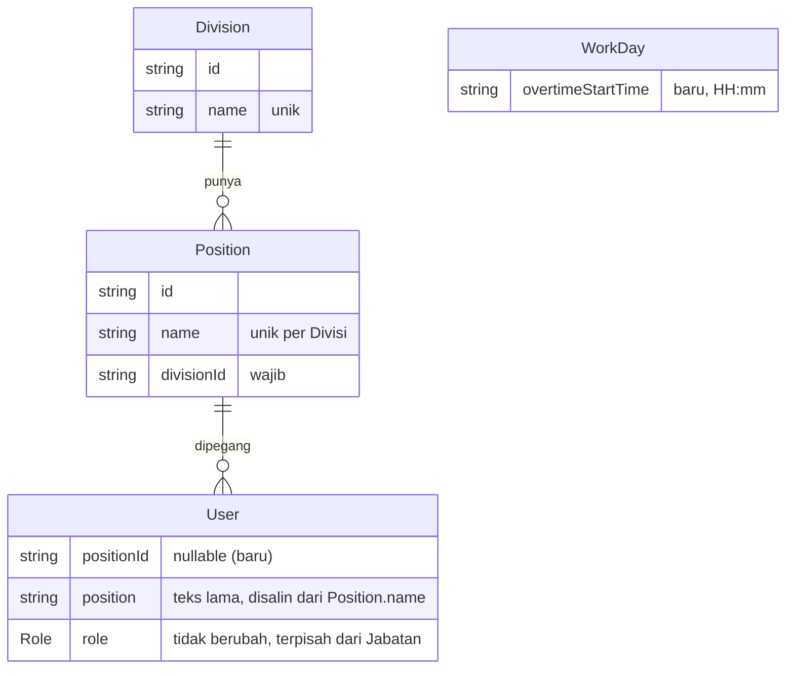
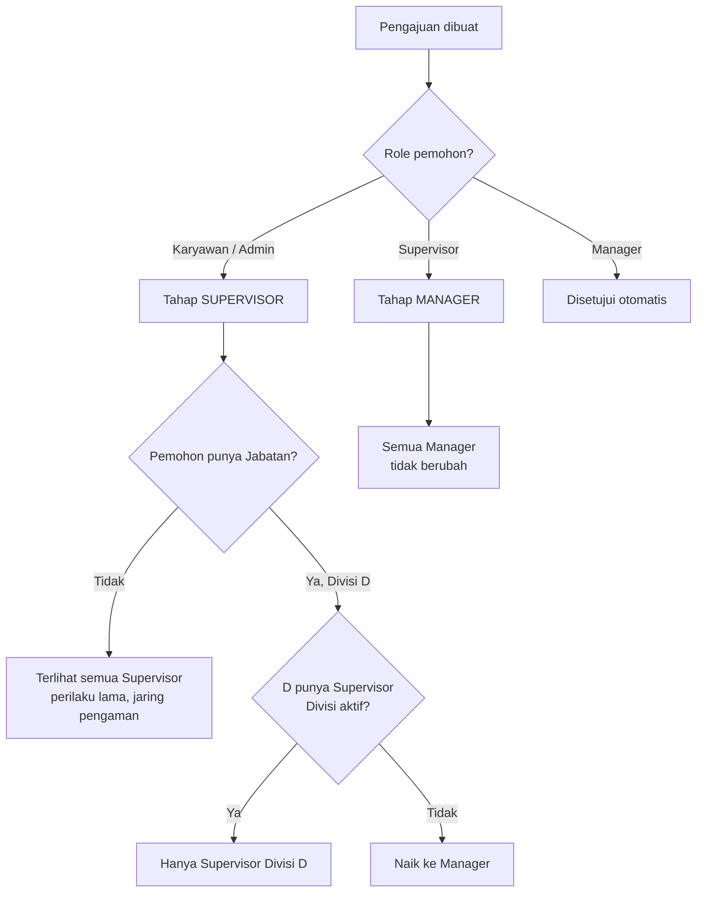

# Panduan review: Divisi, Jam Mulai Lembur & Sabtu, penutupan request account

Dokumen ini ditulis untuk pemilik repo yang akan me-review PR ini. Tujuannya:
kamu bisa memahami **apa** yang berubah, **kenapa**, dan **di mana** — tanpa
harus membaca 152 file satu per satu. Kalau ada baris yang membuatmu bertanya
"kenapa ini diubah?", cari nama filenya di [Bagian 8](#8-referensi-per-file)
atau pertanyaannya di [Bagian 9 (FAQ)](#9-faq--pertanyaan-kenapa-yang-mungkin-muncul).

PR pasangannya di `mobile-tam` punya panduan sendiri di
`mobile-tam/docs/review/divisi-sabtu-request-account.md`.

**Daftar isi**

1. [Ringkasan satu menit](#1-ringkasan-satu-menit)
2. [Apa yang berubah untuk pengguna](#2-apa-yang-berubah-untuk-pengguna)
3. [Cara membaca PR ini](#3-cara-membaca-pr-ini)
4. [Gambaran besar](#4-gambaran-besar)
5. [Penjelasan per fitur](#5-penjelasan-per-fitur)
6. [Kompatibilitas & urutan rilis](#6-kompatibilitas--urutan-rilis)
7. [Cara memverifikasi sendiri](#7-cara-memverifikasi-sendiri)
8. [Referensi per file](#8-referensi-per-file)
9. [FAQ — pertanyaan "kenapa?" yang mungkin muncul](#9-faq--pertanyaan-kenapa-yang-mungkin-muncul)
10. [Hal yang perlu kamu putuskan / ketahui](#10-hal-yang-perlu-kamu-putuskan--ketahui)

---

## 1. Ringkasan satu menit

PR ini menyelesaikan tiga masalah yang ditemukan di data produksi
(snapshot 18 Nov 2026):

| # | Masalah | Solusi di PR ini |
|---|---|---|
| 1 | **Request account terbuka untuk publik.** Siapa pun (termasuk bot) bisa mengisi form atau memanggil `POST /api/account-requests`. | Halaman `/request-account` sekarang langsung redirect ke `/login`. Endpoint membalas **410 Gone**. Di halaman login ada dialog **Hubungi Admin** (email `admin@tarunagroup.co.id`, tombol salin, tombol kirim email bertemplate). |
| 2 | **Tidak ada Divisi.** Semua Supervisor melihat semua Pengajuan semua karyawan. Antrean absen luar radius menumpuk 474 karena tidak jelas siapa yang bertanggung jawab. | Master data baru **Divisi** dan **Jabatan**. Pengajuan karyawan hanya terlihat oleh **Supervisor Divisi**-nya. Pengajuan Supervisor naik ke Manager. Admin mengelolanya di halaman baru `/admin/divisi`. |
| 3 | **Sabtu dan Lembur salah.** Tombol "Otomatis" Absen Pulang Terlewat selalu mengisi 17:00 (Sabtu seharusnya 14:00) → 47 baris salah. Lembur hanya boleh mulai 18:00 untuk semua hari. Jam pulang yang dipilih sendiri tidak divalidasi (ada pulang 05:00 untuk masuk 08:00). | Kolom baru **Jam Mulai Lembur** per Hari Kerja (Senin–Jumat 18:00, Sabtu 14:00), bisa diatur di menu Waktu Kerja. Jam "Otomatis" mengikuti Jam Pulang hari itu. Jam pulang harus setelah jam masuk. Skrip sekali jalan mengoreksi 47 baris Sabtu dengan jejak audit. |

Prinsip yang dipegang di seluruh PR:

- **Produksi tidak boleh rusak.** Semua migrasi hanya **menambah** (tabel baru,
  kolom nullable/berdefault). Tidak ada `DROP`/`RENAME`. Ada skrip CI yang
  memaksa aturan ini.
- **Aplikasi mobile 1.1.0 yang sudah terpasang tetap jalan** setelah backend
  dirilis. Respons API lama tidak diubah bentuknya; field baru hanya ditambah.
- **Arsitektur tetap sama:** Server Action → validator (Zod) → service (Prisma).
  Aturan bisnis baru ditaruh di modul `lib/` yang **bebas Prisma**, supaya bisa
  diuji tanpa database (pola yang sudah ada di `lib/work-schedule.ts`).
- **Sebelum Jabatan diisi, perilaku routing sama persis dengan sekarang.**
  Divisi baru "aktif" setelah admin mengisi Jabatan orang-orang (lihat
  [Bagian 6](#6-kompatibilitas--urutan-rilis)).

Bukti: `npm run check:unit` hijau (lint 0 error, typecheck, **122 unit test**)
dan `npm run test:int` hijau (**40 integration test** terhadap Postgres
sementara).

---

## 2. Apa yang berubah untuk pengguna

| Siapa | Sebelum | Sesudah |
|---|---|---|
| **Calon karyawan** | Mengisi form "Ajukan pembuatan akun" di web/mobile. | Klik "Hubungi admin" di halaman login → dialog berisi email admin + tombol kirim email dengan template Nama/Email/No. HP/Jabatan/Divisi. |
| **Admin** | Kolom jabatan di form pekerja berupa teks bebas. | Dropdown Jabatan yang dikelompokkan per Divisi. Menu baru **Divisi** (pohon Manager → Divisi → Jabatan → orang, CRUD, pindah Jabatan). Menu Waktu Kerja punya kolom "Lembur mulai" per hari. Tabel pekerja menampilkan "Teknisi · Divisi Teknis". Jam bawaan dialog absen manual mengikuti Jam Pulang hari itu (Sabtu 14:00). |
| **Supervisor** | Melihat & memutuskan semua Pengajuan tahap SUPERVISOR dari semua karyawan. | Hanya Pengajuan anggota Divisinya (+ pemohon yang belum punya Jabatan). Badge sidebar, daftar, detail, dan API mobile ikut tersaring. Membuka detail Pengajuan Divisi lain → 404. Saat membuat Dinas luar, hanya bisa memilih karyawan Divisinya. |
| **Manager** | Hanya Pengajuan tahap MANAGER (milik Supervisor). | Tetap itu, **ditambah** Pengajuan dari Divisi yang **tidak punya Supervisor Divisi aktif**, supaya tidak terlantar. |
| **Karyawan** | Lembur hanya boleh mulai 18:00. Tombol "Otomatis pukul 17:00". | Lembur Sabtu boleh mulai 14:00 (hari biasa tetap 18:00). Dialog Absen Pulang Terlewat menyebut hari ("Absen pulang hari Sabtu, 14 Nov"), jam masuk, dan "Otomatis pukul 14:00". Jam pulang ≤ jam masuk ditolak dengan pesan yang menyebut jam masuknya. |

---

## 3. Cara membaca PR ini

PR ini besar (152 file, +10.773 / −1.155 baris), tapi sebagian besar adalah
test, dokumentasi, dan `package-lock.json`. Kode aplikasi yang benar-benar
mengubah perilaku jauh lebih kecil.

| Kategori | Kira-kira | Perlu dibaca teliti? |
|---|---|---|
| Kode aplikasi (`app/`, `components/`, `servers/`, `lib/`, `hooks/`, `proxy.ts` non-test) | +4.100 / −820 | Ya |
| Test (`*.test.ts`, `*.int.test.ts`, `servers/test/`, `scripts/*.test.mjs`) | +2.400 | Cukup skim nama test-nya — dibaca seperti aturan bisnis |
| Skema & migrasi Prisma | +130 / −20 | **Ya, paling penting** (menyentuh DB produksi) |
| Skrip sekali jalan & guardrail (`scripts/`) | +1.000 | Skim |
| Config tooling (CI, ESLint, Vitest, `package.json`) | +200 | Skim |
| Dokumentasi (`*.md`: `docs/`, `.scratch/`, CLAUDE.md, …) | +2.000 / −280 | Opsional |
| `package-lock.json` | +950 / −30 | Tidak (hasil `npm install -D vitest vite`) |

### Urutan baca yang disarankan

1. **Skema & migrasi** — `prisma/schema.prisma` dan 3 folder di
   `prisma/migrations/2026111*` / `2026112*`. Ini satu-satunya bagian yang
   menyentuh data produksi secara langsung.
2. **Modul aturan (bebas Prisma)** — `lib/approval-routing.ts`,
   `lib/division.ts`, `lib/work-schedule.ts` (fungsi baru di bagian bawah),
   `lib/missed-checkout.ts`, `lib/contact-admin.ts`. Baca test-nya
   (`lib/*.test.ts`) bersamaan: nama test-nya adalah spesifikasi.
3. **Service** — `servers/services/approval-routing.service.ts` (terjemahan
   aturan → filter Prisma) dan `servers/services/division.service.ts`.
4. **Pemakai** — action, halaman, dan API route. Polanya berulang: ambil
   `scope` dari `ApprovalRoutingService`, lalu pakai untuk daftar/hitung/cek.
5. **UI** — `components/admin/DivisionTreeView.tsx` (halaman graph Divisi) dan
   dialog-dialog kecil.

### Peta commit → tiket

Setiap tiket punya file di `.scratch/divisi-sabtu-request-account/issues/` yang
berisi kriteria selesai dan catatan verifikasinya.

| Tiket | Commit | Isi |
|---|---|---|
| 01 Pasang Vitest | `0beea2a`, `491be73` | Test runner + guardrail `npm run check` + aturan lint "lib bebas Prisma" |
| 02 Jam Mulai Lembur | `b7d1c3e`, `def0460`, `6171f4d` | Kolom `WorkDay.overtimeStartTime`, validasi, form Waktu Kerja + guardrail migrasi "hanya menambah" |
| 04 Absen Pulang Terlewat | `5fdd62b`, `cdb05e6`, `6720aa0` | Jam otomatis = Jam Pulang hari itu, validasi > jam masuk, dialog baru |
| 07 Tutup request account | `0f5d9f1` | Redirect, 410, dialog Hubungi Admin |
| 09 Divisi & Jabatan | `f627c43`, `36932bc` | Tabel baru, halaman `/admin/divisi`, integration test DB sementara |
| (tooling) | `db1604c`, `35ded94` | Proxy referensi mobile untuk loop parity, CLAUDE.md dirampingkan |
| 10 Form pekerja | `fb7f0fa`, `494efdc` | Dropdown Jabatan per Divisi |
| 11 Routing izin & Lembur | `d49fdf9`, `48b8741` | Modul routing + penerapan ke izin & Lembur |
| (spec) | `e14533b` | Spec, tiket, GLOSSARY, ADR di-commit |
| 06 Skrip koreksi Sabtu | `583a4b8`, `a3a52cf`, `c6ed347` | Skrip 47 baris Sabtu |
| 08 Mobile Hubungi Admin | `2eb4952` | Catatan verifikasi (kodenya di repo mobile) |
| 13 Dinas luar per Divisi | `723cd10` (+ merge `c34bacf`) | Pilihan karyawan dibatasi ke Divisi |
| 14 Skrip pemetaan Divisi | `182859c` (+ merge `362e1d0`) | Skrip isi Jabatan awal |
| 12 Routing absen luar radius | `ab8e8ad` (+ merge `7a23da4`, `ad898bc`) | Routing untuk antrean 474 absen luar radius |
| 15 Dokumentasi | `36276b6` | CLAUDE.md, README, docs |
| (review) | `b168c2e`, `88d8ce8` | Perbaikan hasil code review tiket 12–14 |
| (pasca-rilis) | `ae110a7` | Lembur Sabtu mulai **14:00** (bukan 15:00) — migrasi data kecil |

Tiket 03 dan 05 ada di repo `mobile-tam`.

---

## 4. Gambaran besar

### Lapisan kode (tidak berubah, hanya ditambah)

```text
app/action/*.action.ts  ── validasi input (servers/validators) ── panggil service
app/api/**/route.ts     ──┘
        │
        ▼
servers/services/*.service.ts   ← satu-satunya yang boleh menyentuh Prisma
        │                           (sekarang dipaksa ESLint)
        ├── memakai aturan murni dari lib/*.ts  ← bebas Prisma, diuji Vitest
        ▼
lib/prisma.ts → PostgreSQL
```

File baru mengikuti pola ini:

```diff
 lib/
+├── approval-routing.ts      # siapa boleh melihat/memutuskan Pengajuan
+├── division.ts              # pohon Divisi, definisi Supervisor Divisi
+├── missed-checkout.ts       # data tampilan dialog Absen Pulang Terlewat
+├── contact-admin.ts         # teks & mailto dialog Hubungi Admin
+├── saturday-correction.ts   # rencana koreksi 47 baris Sabtu
+├── division-mapping.ts      # rencana pemetaan Jabatan awal
 └── work-schedule.ts         # + canStartOvertimeAt, autoCheckOutTimeFor, ...
 servers/services/
+├── approval-routing.service.ts   # aturan routing → filter Prisma
+├── division.service.ts           # CRUD Divisi/Jabatan + sinkron User.position
+├── division-mapping.service.ts   # dipakai skrip pemetaan
+├── saturday-correction.service.ts# dipakai skrip koreksi Sabtu
+└── migration.service.ts          # skrip cek migrasi sudah diterapkan
```

### Model data baru



Yang **sengaja tidak ada**: kolom `divisionId` di `User`, kolom `supervisorId`
di `Division`, dan kolom Divisi di `LeaveRequest`/`Overtime`/`Attendance`.
Alasannya di [FAQ](#9-faq--pertanyaan-kenapa-yang-mungkin-muncul) dan dua ADR
di `docs/adr/`.

### Aturan routing dalam satu gambar



Tambahan: Supervisor yang **belum punya Jabatan** tetap melihat semua
Pengajuan tahap SUPERVISOR (perilaku lama). Stage awal per Role **tidak
berubah** — yang berubah hanya *siapa* di tahap itu yang boleh melihat.

---

## 5. Penjelasan per fitur

### 5A. Request account ditutup + dialog Hubungi Admin (tiket 07)

**Apa:** halaman, server action, dan endpoint publik untuk membuat
`AccountRequest` baru dihapus/ditutup. Halaman admin `/admin/permintaan-akun`
dan aksi review **tetap ada**, supaya Pengajuan lama yang masih PENDING bisa
dituntaskan.

**Alur sekarang:**

```text
/request-account (web)      → redirect("/login")
POST /api/account-requests  → 410 { error: "Pendaftaran mandiri ditutup. Hubungi admin di admin@tarunagroup.co.id." }
/login                      → "Belum punya akun? Hubungi admin" → <ContactAdminDialog>
                                 ├── email admin + tombol Salin (Clipboard API + toast)
                                 └── tombol "Kirim email" → mailto: dengan subject & body template
```

**File utama:** `app/(auth)/request-account/page.tsx`,
`app/api/account-requests/route.ts`, `components/auth/ContactAdminDialog.tsx`,
`lib/contact-admin.ts`, `proxy.ts`. Dihapus: `components/auth/RequestAccountForm.tsx`,
`requestAccount()` di `app/action/account-request.action.ts`,
`CreateAccountRequestSchema`, `AccountRequestService.create/findPendingByEmail`.

### 5B. Divisi & Jabatan (tiket 09, 10)

**Apa:** dua tabel baru dan satu kolom nullable `User.positionId`. Halaman
graph `/admin/divisi` (khusus Role Admin, desktop) menampilkan pohon
Manager → Divisi → Jabatan → orang, dengan:

- penanda Supervisor Divisi di tiap Divisi dan peringatan "tanpa supervisor";
- kelompok "Belum punya Jabatan";
- tambah/ubah nama/hapus Divisi & Jabatan (hapus ditolak selama masih berisi);
- pindah Jabatan seseorang langsung (tanpa approval).

Form buat/ubah pekerja: kolom jabatan teks bebas diganti dropdown Jabatan
dikelompokkan per Divisi. Manager tidak bisa diberi Jabatan (dicek di form,
validator, dan action).

**Aturan penting yang dijaga `DivisionService`:** kolom teks lama
`User.position` selalu disalin dari nama Jabatan setiap kali `positionId`
diubah atau Jabatan diganti nama — dalam transaksi yang sama. Ini supaya
mobile 1.1.0 (yang membaca `position` sebagai string) tetap menampilkan
jabatan yang benar.

**File utama:** `prisma/schema.prisma`, migrasi `20261118020000_division_position`,
`lib/division.ts`, `servers/services/division.service.ts`,
`servers/validators/division.validator.ts`, `app/action/division.action.ts`,
`app/(admin)/admin/divisi/page.tsx`, `components/admin/DivisionTreeView.tsx`,
`components/admin/CreateEmployeeForm.tsx`, `components/admin/EditEmployeeAccountForm.tsx`,
`app/action/user.action.ts`.

### 5C. Routing Pengajuan per Divisi (tiket 11, 12, 13)

**Apa:** satu modul aturan (`lib/approval-routing.ts`) menjawab dua hal:

- `canReviewRequest()` — boleh tidak reviewer ini memutuskan Pengajuan ini?
- `getApprovalScope()` — cakupan antrean reviewer ini, berupa salah satu dari
  `none` / `all` / `division` / `manager`.

`ApprovalRoutingService` menerjemahkan cakupan itu menjadi filter Prisma
(`buildLeaveWhereForScope`, `buildOvertimeWhereForScope`,
`buildAttendanceWhereForScope`) — **satu terjemahan untuk ketiga jenis
Pengajuan**, sehingga daftar, badge, dan aksi selalu sepakat.

**Diterapkan di semua titik yang membaca atau memutuskan Pengajuan:**

| Titik | File |
|---|---|
| Daftar pending untuk mobile | `app/api/leave/pending`, `app/api/overtime/pending`, `app/api/attendance/pending` |
| Halaman desktop Supervisor | `app/(supervisor)/supervisor/{izin,lembur,verifikasi}/**` |
| Halaman desktop Manager | `app/(manager)/manager/{izin,lembur,verifikasi}/**` |
| Badge sidebar | `servers/services/notification.service.ts` |
| **Aksi review** (bukan cuma disembunyikan) | `reviewLeaveRequest`, `reviewOvertime`, `reviewAttendance`, `approveAllPendingAttendance` |
| Dinas luar (pilihan karyawan + validasi) | `servers/services/field-assignment.service.ts`, `app/api/users/route.ts`, `app/action/field-assignment.action.ts`, `app/(supervisor)/supervisor/dinas-luar/page.tsx` |

**Absen luar radius** sedikit berbeda karena `Attendance` tidak punya kolom
`stage`: tahapnya diturunkan dari Role pemilik (karyawan/admin → SUPERVISOR,
supervisor → MANAGER), lalu cakupan Divisi ditumpuk di atasnya. Admin tetap
boleh memutuskan absensi siapa pun kecuali miliknya sendiri (cakupan khusus
`{ kind: "admin" }`).

**Routing dihitung saat review**, dari Jabatan pemohon *hari ini*. Akibatnya
474 Pengajuan lama langsung terbagi ke Divisi masing-masing begitu Jabatan
diisi, tanpa backfill. Lihat `docs/adr/0002-routing-pengajuan-saat-review.md`.

Penjelasan lengkap (tabel aturan, letak kode): `docs/approval-routing.md`.

### 5D. Jam Mulai Lembur per Hari Kerja (tiket 02 + perubahan 20 Nov)

**Apa:** kolom `WorkDay.overtimeStartTime` ("HH:mm"). Menggantikan konstanta
`MIN_OVERTIME_HOUR = 18` yang dihapus dari `lib/overtime.ts`.

- Migrasi `20261118010000` mengisi Jam Pulang + 1 jam untuk semua hari
  (Senin–Jumat 18:00 — **sama dengan perilaku lama**).
- Migrasi `20261120010000` lalu mengubah **Sabtu saja** menjadi sama dengan
  Jam Pulang Sabtu (14:00), dan hanya kalau admin belum mengubahnya.
- Setelah itu nilainya berdiri sendiri: mengubah Jam Pulang tidak ikut
  mengubah Jam Mulai Lembur.
- Validasi menu Waktu Kerja: Jam Mulai Lembur tidak boleh sebelum Jam Pulang
  (`hasValidOvertimeStart`).
- Satu aturan `canStartOvertimeAt()` dipakai server (penentu), form web, dan
  drawer mobile-web. Pesan error menyebut jamnya: "Lembur hari ini baru bisa
  dimulai pukul 14:00".
- `/api/settings` sudah mengirim `workDays` apa adanya, jadi kolom baru ikut
  terkirim ke mobile tanpa mengubah route.

### 5E. Absen Pulang Terlewat (tiket 04)

**Apa:**

```diff
 confirmMissedCheckout(workDate, time?)
-  time = time || "17:00"
+  time = time || autoCheckOutTimeFor(workDate, workDays)   // Jam Pulang hari itu
+  if missedCheckoutTimeError(time, jamMasuk)               // pulang harus > masuk
+    return { ok: false, error: "Jam pulang harus setelah jam masuk 08:00" }
   simpan
```

- Validasi di server **menentukan**, karena mobile 1.1.0 tidak memvalidasi.
- `GET /api/attendance/missed` sekarang mengirim `missedDays` (label hari,
  jam masuk, jam otomatis — semuanya diformat di server) **di samping** `days`
  lama, supaya mobile 1.1.0 tetap jalan.
- Dialog web (`components/employee/MissedCheckoutDialog.tsx`) menampilkan
  judul "Absen pulang hari Sabtu, 14 Nov", jam masuk, dan "Otomatis pukul
  14:00". Di bawah `md` tampilannya menyalin modal aplikasi mobile (aturan
  `MOBILE_PARITY.md`); di desktop tetap gaya dialog shadcn.
- Kalau jam otomatis justru sebelum jam masuk (mis. masuk di hari libur
  sesudah Jam Pulang), tombol "Otomatis" disembunyikan dan karyawan wajib
  memilih jam sendiri.
- Dialog absen manual admin (`ManualAttendanceDialog`) memakai Jam Pulang hari
  yang dipilih sebagai jam bawaan, bukan 17:00.

### 5F. Dua skrip sekali jalan (tiket 06, 14)

| Skrip | Fungsi | Hasil yang diharapkan |
|---|---|---|
| `scripts/koreksi-sabtu.ts` | Koreksi absen pulang Sabtu yang tercatat 17:00 oleh tombol "Otomatis" lama menjadi 14:00. Jam asli disimpan di `originalTimestamp`, tampil "Diubah admin" dengan catatan "Koreksi sistem: …". | 47 baris |
| `scripts/pemetaan-divisi.ts FILE` | Buat Divisi Admin & Teknis beserta Jabatannya, lalu isi Jabatan orang sesuai file pemetaan lokal (id + email). | Sesuai daftar di spec |

Keduanya memakai pola keamanan yang sama:

- default **dry-run**; perubahan baru ditulis dengan `--apply`;
- semua perubahan dalam **satu transaksi**;
- cek dulu `_prisma_migrations` sudah memuat migrasi yang dibutuhkan;
- **idempoten** (jalan kedua tidak mengubah apa pun);
- berhenti total kalau ada yang tidak cocok (mis. Sally ternyata bukan
  SUPERVISOR, email tidak cocok, Jam Pulang Sabtu bukan 14:00).

Daftar orang untuk pemetaan **tidak di-commit** (data pribadi karyawan); hanya
contoh rekaan `scripts/pemetaan-divisi.example.csv`. `.gitignore` mencegah
file asli ikut ter-commit. `scripts/wizard-skrip-produksi.sh` memandu langkah
backup → restore ke lokal → dry-run → gladi `--apply` → produksi.

Logika aturannya ada di `lib/saturday-correction.ts` dan
`lib/division-mapping.ts` (diuji unit), akses DB di service-nya (diuji
integration).

### 5G. Tooling: test, guardrail, CI (tiket 01 + retro)

Sebelum PR ini repo belum punya test. Yang ditambahkan:

| Perintah | Isi |
|---|---|
| `npm test` | Vitest untuk modul `lib/**` (bebas DB) dan unit test service |
| `npm run test:int` | Integration test service terhadap database Postgres **sementara** (dibuat & dihapus otomatis oleh `scripts/with-temp-db.mjs`) |
| `npm run check:migrations` | Gagal kalau migrasi baru berisi `DROP`, `RENAME`, ganti tipe, `SET NOT NULL`, dll. |
| `npm run db:check-drift` | Gagal kalau `schema.prisma` dan folder migrasi tidak sinkron |
| `npm run check:unit` | prisma validate + format + check migrations + lint + typecheck + test (tanpa Postgres) |
| `npm run check` | `check:unit` + `test:int` — yang dijalankan CI |

ESLint ditambah dua aturan struktural (dari arsitektur yang sudah tertulis di
CLAUDE.md, sekarang dipaksa mesin):

1. Hanya `servers/services/**` yang boleh mengimpor `lib/prisma`.
2. Modul `lib/**` bebas Prisma/Clerk/service secara default; modul lama yang
   memang butuh DB masuk daftar `ignores`.

CI baru: `.github/workflows/check.yml` (Postgres 16 sebagai service).

### 5H. Dokumentasi

- `CLAUDE.md` dirampingkan; detail aturan dipindah ke
  `docs/attendance-rules.md` dan `docs/approval-routing.md`.
- `GLOSSARY.md` — istilah domain (Divisi, Jabatan, Supervisor Divisi,
  Pengajuan, Jam Mulai Lembur, …) supaya kode, UI, dan diskusi memakai kata
  yang sama.
- `docs/adr/0001`, `0002` — dua keputusan arsitektur yang sulit dibalik.
- `CODING_STANDARDS.md` — standar yang dipakai saat code review.
- `docs/agents/*`, `.scratch/…` — konfigurasi alur kerja agent (issue tracker
  lokal, label triage). Lihat [Bagian 10](#10-hal-yang-perlu-kamu-putuskan--ketahui).

---

## 6. Kompatibilitas & urutan rilis

### Kenapa aman dirilis bertahap

| Kekhawatiran | Jawaban |
|---|---|
| Mobile 1.1.0 memanggil `POST /api/account-requests` | Dapat 410 + `{ error }`; mobile lama menampilkan `error` apa adanya → pengguna melihat "Pendaftaran mandiri ditutup. Hubungi admin di …". |
| Mobile 1.1.0 membaca `GET /api/attendance/missed` | Field `days` tetap ada dan sama; `missedDays` hanya tambahan. |
| Mobile 1.1.0 membaca jabatan sebagai string | `User.position` tetap ada dan selalu disinkronkan dari Jabatan. |
| Mobile 1.1.0 mengirim jam pulang tanpa validasi | Server sekarang yang menolak jam ≤ jam masuk. |
| Mobile 1.1.0 membuat Dinas luar lewat `GET /api/users` | Bentuk respons sama (`id`, `name`, `position`); isinya disaring ke Divisi. |
| Antrean Review di mobile 1.1.0 | Semua penyaringan di server → ikut ter-routing tanpa update aplikasi. |
| Migrasi gagal di tengah | Migrasi hanya menambah tabel/kolom; kode lama tetap jalan di skema baru. |
| Divisi belum diisi setelah deploy | Semua orang `positionId = null` → Supervisor tanpa Jabatan → cakupan `all` = **perilaku lama**. Tidak ada Pengajuan yang hilang. |

### Urutan yang disarankan

```text
1. Backup DB produksi (pg_dump).
2. Deploy backend + `npx prisma migrate deploy`   ← aman untuk mobile 1.1.0
   (Senin–Jumat Lembur tetap 18:00, Sabtu jadi 14:00)
3. Skrip pemetaan Divisi: dry-run → periksa → --apply
   (sejak titik ini routing per Divisi aktif)
4. Skrip koreksi Sabtu: dry-run (harus 47 baris) → --apply
5. Mobile: `eas update` (OTA) — tidak ada modul native baru
```

`scripts/wizard-skrip-produksi.sh` memandu langkah 1, 3, dan 4 (termasuk
restore ke DB lokal untuk gladi). Menjalankan skrip ke produksi dan deploy
**tetap keputusanmu** — PR ini tidak menjalankan apa pun ke produksi.

---

## 7. Cara memverifikasi sendiri

Butuh `.env` (salin `.env.example`, isi `DATABASE_URL` + kunci Clerk dev).

```bash
npm install
```

```bash
npm run check:unit
```

```bash
npm run test:int
```

`test:int` butuh server Postgres lokal (default
`postgresql://localhost:5432/postgres`, atau set `TEMP_DATABASE_SERVER_URL`).
Ia membuat database `tam_temp_*`, memutar semua migrasi, menjalankan test,
lalu menghapus database itu.

Cek manual di UI (`npm run dev`):

1. `/login` → klik "Hubungi admin" → salin & kirim email.
2. `/request-account` → harus pindah ke `/login`.
3. Login admin → menu **Divisi** → buat Divisi, Jabatan, pindahkan orang.
4. Menu **Waktu Kerja** → kolom "Lembur mulai"; coba isi sebelum Jam Pulang → ditolak.
5. Login sebagai Supervisor yang punya Jabatan → antrean izin/lembur/verifikasi
   hanya berisi Divisinya.

Test yang paling enak dibaca sebagai spesifikasi:
`lib/approval-routing.test.ts` (contoh: "Kriteria 2: Supervisor Admin tidak
bisa menyetujui izin Teknisi (ditolak)" dan "Kriteria 4: Tanpa satu pun
Jabatan terisi, perilaku identik dengan sebelum fitur ini"),
`lib/work-schedule.test.ts` ("Senin Lembur belum boleh pukul 17:30, boleh
mulai 18:00"), `servers/services/attendance-routing.service.int.test.ts`.

---

## 8. Referensi per file

Format: **file** — apa yang berubah → *kenapa*. Diurutkan per folder.
(B = file baru, H = dihapus.)

### Skema & migrasi

| File | Perubahan | Alasan |
|---|---|---|
| `prisma/schema.prisma` | Model `Division`, `Position` (B); `User.jobPosition`/`positionId` + index; `WorkDay.overtimeStartTime`; komentar `Attendance.timestamp` & `Overtime.startAt`. Sisanya perataan spasi oleh `prisma format`. | Divisi dibaca lewat Jabatan (ADR 0001). `onDelete: Restrict` supaya Jabatan/Divisi tidak bisa dihapus selama masih dipakai. Komentar timestamp mencegah salah tulis jam di SQL mentah (kolom menyimpan UTC). |
| `prisma/migrations/20261118010000_work_day_overtime_start/migration.sql` (B) | Tambah kolom default `'18:00'`, lalu isi Jam Pulang + 1 jam (dibatasi 23:59). | Default membuat kode lama yang membuat `WorkDay` tetap jalan. Backfill membuat Senin–Jumat tetap 18:00 = tidak ada perubahan perilaku. |
| `prisma/migrations/20261118020000_division_position/migration.sql` (B) | Tabel `Division`, `Position`, kolom nullable `User.positionId`, index & FK. | Hanya menambah; `User.position` tidak disentuh supaya mobile lama aman. |
| `prisma/migrations/20261120010000_saturday_overtime_at_check_out/migration.sql` (B) | Set Jam Mulai Lembur Sabtu = Jam Pulang Sabtu, hanya kalau masih nilai awal. | Keputusan pasca-rilis: Lembur Sabtu mulai tepat 14:00. Syarat `WHERE` mencegah menimpa pilihan admin dan membuatnya aman dijalankan ulang. |
| `prisma/seed.ts` | Isi `overtimeStartTime: "18:00"`. | Seed harus sesuai kolom baru. |
| `prisma.config.ts` | URL placeholder kalau `DATABASE_URL` kosong; `shadowDatabaseUrl`. | `prisma generate/validate` di CI tidak butuh DB sungguhan. Shadow DB untuk `db:check-drift`. |

### `lib/` — modul aturan

| File | Perubahan | Alasan |
|---|---|---|
| `lib/approval-routing.ts` (B) | `getApprovalScope`, `canReviewRequest`, `isTurnToReview`, `canViewRequest`, `resolveActiveSupervisorDivisionIds`. | Satu-satunya tempat aturan "siapa melihat/memutuskan Pengajuan". Bebas Prisma → diuji tanpa DB. |
| `lib/division.ts` (B) | `buildDivisionTree`, `isDivisionSupervisor`, `canHavePosition`, `normalizePositionId`, `formatWorkerPosition`, `NO_POSITION`. | Definisi tunggal Supervisor Divisi & aturan "Manager tanpa Jabatan", dipakai form client dan server. `NO_POSITION` karena Select Radix tidak menerima value kosong. |
| `lib/work-schedule.ts` | `overtimeStartTime` di `WorkDayConfig` & default; fungsi baru `canStartOvertimeAt`, `hasValidOvertimeStart`, `autoCheckOutTimeFor`, `missedCheckoutTimeError`. Satu fungsi hanya diformat ulang. | Aturan jadwal tetap di satu modul (pola `isLateAt`). Pesan error dibuat di sini supaya server & dialog menampilkan teks yang sama. |
| `lib/missed-checkout.ts` (B) | Tipe `MissedCheckoutDay` + `describeMissedCheckout()`. | Tanggal/jam diformat di server (aturan CLAUDE.md) dan dipakai bersama oleh API mobile dan dialog web. |
| `lib/contact-admin.ts` (B) | Email admin, judul, deskripsi, template, pesan 410, `contactAdminMailto()`. | Satu sumber teks untuk dialog, endpoint, dan salinan mobile. `encodeURIComponent` (bukan `URLSearchParams`) supaya spasi tidak jadi `+` di aplikasi email. |
| `lib/saturday-correction.ts` (B) | Syarat sasaran koreksi & rencana koreksi. | Aturan skrip diuji unit; target 14:00 dikunci supaya skrip berhenti kalau `WorkDay` berkata lain. |
| `lib/division-mapping.ts` (B) | Struktur Divisi awal, parser CSV/JSON, rencana pemetaan dengan validasi. | Pemetaan berdasarkan id + email (bukan nama) dan berhenti kalau Role tidak sesuai dugaan. |
| `lib/date.ts` | `formatDayShortDate()` ("Sabtu, 14 Nov"). | Judul dialog Absen Pulang Terlewat. |
| `lib/attendance.ts` | Cabang ADMIN di `ownerRolesForAttendanceReviewer` dan fungsi `canReviewAttendance` dihapus. | Dipindah ke `ApprovalRoutingService` karena sekarang butuh data Divisi; aturan Admin ditaruh di satu tempat (`getAttendanceScopeForReviewer`). |
| `lib/overtime.ts` | `MIN_OVERTIME_HOUR` & `isOvertimeStartAllowed` dihapus. | Diganti `canStartOvertimeAt` per Hari Kerja. |
| `lib/prisma.ts` | Tipe `Db = Prisma.TransactionClient`. | Service bisa ikut transaksi pemanggil (dipakai skrip). |
| `lib/sidebar-menu.ts` | Menu "Divisi" untuk ADMIN. | Akses halaman baru. |
| `lib/crypto.ts` | Komentar saja. | Mencatat bahwa form request account sudah ditutup. |
| `lib/*.test.ts` (B, 6 file) | Test approval-routing, contact-admin, division-mapping, division, saturday-correction, work-schedule. | Bukti aturan bisnis; contoh dari kasus produksi nyata. |
| `hooks/use-mobile.ts` | `useState`+`useEffect` → `useSyncExternalStore`. | Aturan lint `react-hooks/set-state-in-effect` (bagian dari menghijaukan `npm run check`); perilaku sama. |
| `proxy.ts` | `/request-account` dihapus dari rute publik. | Rute hanya redirect; tidak perlu publik. |

### `servers/` — service & validator

| File | Perubahan | Alasan |
|---|---|---|
| `servers/services/approval-routing.service.ts` (B) | Ambil Divisi user & Divisi yang punya Supervisor aktif; `getScopeForReviewer`, `getAttendanceScopeForReviewer`, `canReview*`, `canView`; builder filter Prisma. | Jembatan antara aturan murni dan Prisma. Satu `buildWhereForScope` untuk tiga jenis Pengajuan supaya tidak ada yang berbeda. |
| `servers/services/division.service.ts` (B) | CRUD Divisi/Jabatan, `assignPosition`, `listStructure`, `listPositionGroups`. | Satu-satunya yang menulis `User.position` saat Jabatan berubah, dalam transaksi. Hapus dicek dulu → pesan jelas, bukan error FK. |
| `servers/services/division-mapping.service.ts` (B) | Dry-run & apply pemetaan dalam satu transaksi. | Dipakai skrip; melempar error (bukan return) supaya transaksi rollback kalau hasil tidak tuntas. |
| `servers/services/saturday-correction.service.ts` (B) | Dry-run & apply koreksi Sabtu. | `updateMany` mengulang syarat (`editedAt: null`, timestamp lama) supaya baris yang berubah sejak dibaca tidak ikut. |
| `servers/services/migration.service.ts` (B) | `checkApplied(name)`. | Skrip menolak jalan di DB yang belum dimigrasi / salah DB, dengan pesan jelas. |
| `servers/services/attendance.service.ts` | `listPendingApprovalForOwnerRoles` → `…ForScope`; begitu juga count & `approveAllPending`; `getById` include `jobPosition`. | Antrean absen luar radius ikut cakupan Divisi. Include dibutuhkan pengecekan Divisi pemilik. |
| `servers/services/leave.service.ts` | Opsi `scope`/`where`; `listPendingForScope`, `listForViewer`, `countPendingForScope`; `countPending` menerima scope; include `jobPosition`. | Daftar, riwayat, dan badge tersaring Divisi. |
| `servers/services/overtime.service.ts` | Sama seperti leave. | Sama. |
| `servers/services/field-assignment.service.ts` | `listAssignableEmployees`, `areAssignable`. | Satu filter untuk pilihan di form dan validasi server. Jabatan Supervisor tidak ditemukan → gagal tertutup (tidak ada yang bisa dipilih). |
| `servers/services/notification.service.ts` | Badge Supervisor/Manager memakai scope. | Angka badge harus sama dengan isi daftar. |
| `servers/services/user.service.ts` | Include `jobPosition.division`; terima input `Unchecked`. | Tabel pekerja menampilkan Divisi; `positionId` bisa ditulis sebagai skalar. |
| `servers/services/account-request.service.ts` | `create` & `findPendingByEmail` dihapus. | Tidak ada lagi jalur pembuatan permintaan akun. |
| `servers/validators/division.validator.ts` (B) | Skema Divisi, Jabatan, ganti nama, assign. | Batas 60 karakter = batas `User.position`, karena nama Jabatan disalin ke sana. |
| `servers/validators/setting.validator.ts` | `overtimeStartTime` + refine `hasValidOvertimeStart`. | Jam Mulai Lembur tidak boleh sebelum Jam Pulang. |
| `servers/validators/user.validator.ts` | `positionId`; `BaseUserSchema` + `superRefine` "Manager tanpa Jabatan". | Skema dasar dipisah supaya `.partial()`/`.extend()` tetap bisa dipakai, lalu aturan Manager ditempel ke ketiga skema turunan. |
| `servers/validators/account-request.validator.ts` | `CreateAccountRequestSchema` dihapus. | Tidak dipakai lagi. |
| `servers/validators/attendance.validator.ts` | Komentar saja. | "Kosong = 17:00" sudah tidak benar. |
| `servers/services/approval-routing.service.test.ts` (B) | Unit test builder filter Prisma. | Memastikan terjemahan scope → `where` benar tanpa DB. |
| `servers/services/*.int.test.ts` (B, 5 file) + `servers/test/saturday-overtime-migration.int.test.ts` + `servers/test/setup.ts` | Integration test routing absen, pemetaan, Divisi, Dinas luar, koreksi Sabtu, migrasi Sabtu, cek migrasi; setup yang mengosongkan tabel. | Aturan yang hidup di DB (transaksi, FK, sinkron kolom teks) hanya bisa dibuktikan dengan Postgres sungguhan. Setup menolak jalan di DB selain `tam_temp_*`. |

### `app/` — action, halaman, API

| File | Perubahan | Alasan |
|---|---|---|
| `app/action/division.action.ts` (B) | 7 action Admin (CRUD Divisi/Jabatan, assign). Error Prisma P2002/P2025/P2003 diterjemahkan jadi pesan. | Admin mendapat pesan yang bisa ditindak ("Divisi X sudah ada") bukan error mentah. |
| `app/action/leave.action.ts` | `reviewLeaveRequest`: hapus penentuan stage dari Role; tambah cek ada/PENDING/`canReviewLeave`; review memakai `leave.stage`. | Manager sekarang bisa memutuskan Pengajuan tahap SUPERVISOR (Divisi tanpa Supervisor), jadi stage tidak bisa lagi ditebak dari Role. Cek wewenang di aksi mencegah lewat API. |
| `app/action/overtime.action.ts` | Sama untuk `reviewOvertime`; `startOvertime` memakai `canStartOvertimeAt` + Jam Mulai Lembur hari ini. | Sama + Lembur per Hari Kerja. |
| `app/action/attendance.action.ts` | `reviewAttendance` & `approveAllPendingAttendance` lewat `ApprovalRoutingService`; `confirmMissedCheckout` memakai jam otomatis per hari + validasi > jam masuk; konstanta 17:00 dihapus. | Routing absen luar radius; perbaikan Sabtu; validasi server sebagai penentu. |
| `app/action/user.action.ts` | Create/update menerima `positionId`, menolak Manager ber-Jabatan, memanggil `DivisionService.assignPosition`; revalidate `/admin/divisi`. | Form pekerja memakai dropdown Jabatan; teks jabatan disinkronkan service, bukan ditulis bebas. |
| `app/action/field-assignment.action.ts` | Validasi karyawan lewat `areAssignable`. | Supervisor tidak bisa menugaskan karyawan Divisi lain walau memanggil action langsung. |
| `app/action/account-request.action.ts` | `requestAccount()` dihapus; komentar review diperbarui. | Pendaftaran mandiri ditutup; review hanya untuk antrean lama. |
| `app/api/account-requests/route.ts` | Selalu 410 + pesan, body tidak dibaca. | Mobile 1.1.0 masih memanggilnya dan menampilkan `error`. 410 = "pernah ada, sengaja ditutup". |
| `app/api/attendance/missed/route.ts` | Tambah `missedDays`. | Data dialog baru; `days` dipertahankan untuk mobile lama. |
| `app/api/{leave,overtime,attendance}/pending/route.ts` | Pakai scope. | Tab Review mobile ikut ter-routing tanpa update aplikasi. |
| `app/api/users/route.ts` | Pakai `listAssignableEmployees`. | Pilihan Dinas luar di mobile ikut Divisi; bentuk respons sama. |
| `app/(admin)/admin/divisi/page.tsx` (B) | Halaman graph Divisi. | Fitur 5B. `requireRole` diulang supaya tetap aman kalau dipindah. |
| `app/(admin)/admin/daftar-pekerja/page.tsx` | Kirim nama Divisi ke tabel. | Tampilan "Teknisi · Divisi Teknis". |
| `app/(admin)/admin/daftar-pekerja/baru/page.tsx`, `…/[id]/edit/page.tsx` | Ambil `positionGroups`, kirim ke form. | Isi dropdown Jabatan. |
| `app/(admin)/admin/waktu-kerja/page.tsx` | Kirim `overtimeStartTime`; subtitle. | Kolom baru di form. |
| `app/(admin)/admin/kehadiran/page.tsx` | Kirim `workDays` ke dialog & tabel. | Jam bawaan absen pulang manual = Jam Pulang hari itu. |
| `app/(auth)/login/page.tsx` | Link request account → `ContactAdminDialog`. | Fitur 5A. |
| `app/(auth)/request-account/page.tsx` | Jadi `redirect("/login")`. | Tautan lama tidak 404. |
| `app/(employee)/lembur/page.tsx` | Ambil Jam Mulai Lembur hari ini. | Drawer Lembur mobile-web menampilkan batas yang benar. |
| `app/(supervisor)/supervisor/izin/page.tsx`, `lembur/page.tsx` | Daftar lewat `listForViewer`, hitung "giliran saya" lewat scope. | Riwayat & angka hanya Divisinya. |
| `app/(supervisor)/supervisor/izin/[id]/page.tsx`, `lembur/[id]/page.tsx` | `canView` → 404, `canReview` ke komponen. | Tidak bisa membuka Pengajuan Divisi lain lewat URL. |
| `app/(supervisor)/supervisor/verifikasi/page.tsx` | Antrean lewat scope. | Routing absen luar radius. |
| `app/(supervisor)/supervisor/dinas-luar/page.tsx` | Pilihan karyawan lewat `listAssignableEmployees`. | Fitur 5C Dinas luar. |
| `app/(manager)/manager/izin/page.tsx`, `lembur/page.tsx` | `isMyTurn` per baris dari `isTurnToReview`; hitung lewat scope. | Baris tahap SUPERVISOR dari Divisi tanpa Supervisor harus memunculkan tombol "Tinjau" untuk Manager. |
| `app/(manager)/manager/izin/[id]/page.tsx`, `lembur/[id]/page.tsx` | `canReview` ke komponen. | Sama. |
| `app/(manager)/manager/verifikasi/page.tsx` | Antrean lewat scope. | Sama. |

### `components/`

| File | Perubahan | Alasan |
|---|---|---|
| `components/admin/DivisionTreeView.tsx` (B, ~720 baris) | Client component halaman graph: `ManagerNode`, `DivisionCard`, `PositionItem`, `PersonRow`, `UnassignedCard`, dialog nama/hapus/pindah. | Dibangun dari komponen shadcn yang sudah ada; tidak menambah library graph. |
| `components/auth/ContactAdminDialog.tsx` (B) | Dialog Hubungi Admin. | Fitur 5A. Clipboard dibungkus try/catch (konteks http non-localhost tidak punya `navigator.clipboard`). |
| `components/auth/RequestAccountForm.tsx` (H) | Dihapus. | Form tidak dipakai lagi. |
| `components/admin/CreateEmployeeForm.tsx`, `EditEmployeeAccountForm.tsx` | Input teks jabatan → Select Jabatan per Divisi; disabled untuk Manager. | Fitur 5B. |
| `components/admin/WorkerTable.tsx` | Tampilkan Jabatan + Divisi. | Tampilan tabel pekerja. |
| `components/admin/WorkScheduleForm.tsx` | Kolom "Lembur mulai" + pesan error; tombol "samakan semua" ikut menyalin. | Fitur 5D. |
| `components/admin/ManualAttendanceDialog.tsx` | Jam bawaan absen pulang dari `autoCheckOutTimeFor`; state `pickedTime`. | Bukan 17:00 untuk Sabtu. `null` = ikut bawaan tanggal terpilih, sehingga ganti tanggal ikut mengganti jam. |
| `components/admin/AttendanceRecapTable.tsx` | Prop `editDate` → `edit { workDate, workDays }`. | Meneruskan Hari Kerja ke dialog di atas. |
| `components/employee/MissedCheckoutDialog.tsx` | Judul hari, jam masuk, jam otomatis, validasi; tampilan mobile di bawah `md`. | Fitur 5E + aturan parity. Disusun dari `DialogPortal`+`DialogOverlay` karena `DialogContent` tidak bisa mengatur overlay. |
| `components/dashboard/SelfAttendanceDashboard.tsx` | Data dialog lewat `describeMissedCheckout`. | Fitur 5E. |
| `components/dashboard/SelfOvertimeDashboard.tsx`, `components/overtime/SelfOvertimeForm.tsx` | Jam Mulai Lembur hari ini sebagai default, `min`, dan cek awal. | Fitur 5D (server tetap penentu). |
| `components/mobile/beranda/{home,home-screen,overtime-start-drawer}.tsx`, `components/mobile/lembur/lembur-screen.tsx` | Teruskan & pakai `overtimeStartTime`; konstanta 18 dihapus. | Drawer mulai Lembur di web mobile. |
| `components/leave/LeaveApprovalTable.tsx`, `LeaveDetailView.tsx`, `components/overtime/OvertimeApprovalTable.tsx`, `OvertimeDetailView.tsx` | Prop opsional `isMyTurn` / `canReview` (fallback ke logika lama). | Halaman menentukan wewenang lewat routing; komponen tidak menebak dari stage. |
| `components/dashboard/ToggleTheme.tsx` | `useEffect` mounted → `useSyncExternalStore`. | Aturan lint `set-state-in-effect`; perilaku sama. |

### Skrip & tooling

| File | Perubahan | Alasan |
|---|---|---|
| `scripts/check-migrations.mjs` (B) + `.test.mjs` | Guardrail migrasi hanya menambah (sesudah baseline `20260919010000`). Bisa dikecualikan per statement dengan komentar `-- migration-safety: allow <alasan>`. | Produksi & mobile lama tidak boleh rusak karena migrasi. |
| `scripts/with-temp-db.mjs` (B) | Buat DB sementara, jalankan perintah, hapus DB. | `test:int` dan cek drift lokal tanpa menyentuh DB dev. |
| `scripts/koreksi-sabtu.ts` (B) | CLI skrip koreksi Sabtu. | Fitur 5F. |
| `scripts/pemetaan-divisi.ts` (B) + `pemetaan-divisi.example.csv` (B) | CLI skrip pemetaan + contoh rekaan. | Fitur 5F; data asli tidak di-commit. |
| `scripts/wizard-skrip-produksi.sh` (B) | Wizard interaktif backup → restore → dry-run → apply. | Langkah produksi yang hanya bisa dilakukan manusia, supaya tidak salah urutan. |
| `scripts/parity/mobile-ref.mjs` (B) | Sajikan build web mobile + proxy `/api` ke Next di satu origin. | Loop verifikasi visual mobile-parity; API Next tidak mengirim header CORS. |
| `package.json` | Skrip `test`, `test:int`, `typecheck`, `check*`, `db:check-drift*`, `parity:mobile-ref`; `parity:*` membaca `.env`; devDependency `vitest`, `vite`. | Gate `npm run check`. Tidak ada dependency produksi baru. |
| `package-lock.json` | Hasil instalasi vitest/vite. | Otomatis. |
| `vitest.config.ts`, `vitest.int.config.ts` (B) | Konfigurasi unit & integration. | Integration berjalan berurutan (satu DB). |
| `eslint.config.mjs` | Aturan Prisma hanya di service; `lib/**` bebas Prisma; pengecualian `components/ui/**`. | Arsitektur yang tertulis di CLAUDE.md sekarang dipaksa lint. |
| `.github/workflows/check.yml` (B) | CI: `npm run check` + `db:check-drift` dengan Postgres 16. | Setiap PR berikutnya diuji otomatis. |
| `.gitignore` | Abaikan `pemetaan-divisi*.csv/json` kecuali contoh. | Data pribadi karyawan tidak ter-commit. |
| `.npmrc` (B) | `legacy-peer-deps=false`. | Lockfile tetap sama walau mesin developer punya setting global berbeda. |

### Dokumentasi & alur kerja

| File | Perubahan | Alasan |
|---|---|---|
| `CLAUDE.md` | Dirampingkan; menunjuk ke `docs/`; Divisi, Jam Mulai Lembur, request account ditutup, Dinas luar disetujui Manager. | Panduan untuk agent AI & developer; dulu ada bagian yang sudah tidak benar. |
| `README.md` | Fitur baru & perintah baru. | Sinkron dengan kode. |
| `MOBILE_PARITY.md` | Aturan & loop verifikasi visual web-mobile (termasuk proxy referensi). | Dipakai saat menyentuh tampilan `md:hidden`. |
| `CODING_STANDARDS.md` (B) | Standar: satu definisi per aturan domain, penamaan validator, invariant DB wajib integration test, bahasa domain. | Acuan code review. |
| `GLOSSARY.md` (B) | Istilah domain. | Satu kosakata untuk kode, UI, dan diskusi. |
| `docs/attendance-rules.md` (B) | Aturan absensi & rekap (dipindah dari CLAUDE.md + Jam Mulai Lembur, Absen Pulang Terlewat). | Rujukan sebelum menyentuh absensi. |
| `docs/approval-routing.md` (B) | Aturan routing & letak kodenya. | Rujukan sebelum menyentuh review/antrean. |
| `docs/adr/0001-…`, `0002-…` (B) | Keputusan arsitektur. | Keputusan yang sulit dibalik dicatat beserta alasannya. |
| `docs/agents/{domain,issue-tracker,triage-labels}.md` (B) | Konfigurasi skill agent. | Lihat Bagian 10. |
| `.scratch/divisi-sabtu-request-account/spec.md` + `issues/01…15-*.md` (B) | Spec & 15 tiket dengan catatan verifikasi. | Jejak keputusan & kriteria selesai setiap tiket. Lihat Bagian 10. |
| `docs/review/divisi-sabtu-request-account.md` (B) | Dokumen ini. | Panduan review. |

---

## 9. FAQ — pertanyaan "kenapa?" yang mungkin muncul

### Model data

**Kenapa Divisi tidak disimpan langsung di `User` (`divisionId`)?**
Karena Jabatan sudah pasti milik satu Divisi. Menyimpan keduanya di `User`
berarti ada dua sumber kebenaran yang bisa tidak sinkron (Jabatan "Teknisi"
tapi Divisi "Admin"). Dengan membaca Divisi lewat Jabatan, mustahil tidak
sinkron. (ADR 0001)

**Kenapa tidak ada kolom `supervisorId` di `Division`?**
"Supervisor Divisi" = user aktif ber-Role SUPERVISOR yang Jabatannya di Divisi
itu. Jadi satu Divisi boleh punya lebih dari satu Supervisor, dan menonaktifkan
seorang Supervisor otomatis membuat Divisinya naik ke Manager — tanpa ada
kolom yang perlu diingat untuk diubah.

**Kenapa kolom teks `User.position` tidak dihapus saja?**
Aplikasi mobile 1.1.0 yang sudah terpasang di HP karyawan membacanya sebagai
string. Kalau dihapus, profil mereka kosong sampai update. Jadi kolom itu
dipertahankan dan **selalu disalin** dari nama Jabatan oleh `DivisionService`.
Kalau seseorang tidak punya Jabatan (mis. Manager dengan teks "Business
Development Manager"), teksnya dibiarkan.

**Kenapa Manager tidak punya Jabatan/Divisi?**
Manager membawahi semua Divisi. Divisi "Manajemen" sempat dipertimbangkan,
tapi tidak akan pernah punya Supervisor Divisi, jadi hanya menambah kasus
khusus tanpa mengubah hasil routing.

**Kenapa Role tetap terpisah dari Jabatan?**
Role = hak akses sistem (siapa boleh membuka halaman admin). Jabatan = posisi
di organisasi. "Role Admin", "Divisi Admin", dan "Jabatan Admin" adalah tiga
hal berbeda yang dulu sering tercampur. Contoh nyata: staf Divisi Admin bisa
ber-Role ADMIN, tapi Pengajuannya tetap ke Supervisor Divisi Admin.

**Kenapa hapus Divisi/Jabatan ditolak, bukan cascade?**
Cascade bisa membuat orang tiba-tiba kehilangan Jabatan, yang diam-diam
mengubah ke mana Pengajuannya pergi. Lebih aman memaksa admin memindahkan
orangnya dulu. Ada dua lapis: pengecekan di service (pesan jelas) dan FK
`Restrict` di DB (jaring pengaman).

### Routing

**Kenapa routing dihitung saat review, bukan disimpan di Pengajuan?**
Saat fitur ini dibuat sudah ada 474 Pengajuan absen luar radius pending yang
dibuat sebelum Divisi ada. Kalau Divisi disimpan di Pengajuan, ketiga tabel
harus di-backfill. Dengan dihitung saat review, antrean lama terbagi sendiri
begitu Jabatan diisi. Bonus: kalau seseorang pindah Divisi, Pengajuan pending-nya
ikut ke atasan barunya. Riwayat keputusan tetap stabil karena `ApprovalLog`
menyimpan ringkasan saat keputusan diambil. (ADR 0002)

**Kenapa pemohon tanpa Jabatan terlihat oleh semua Supervisor?**
Jaring pengaman masa transisi: tidak boleh ada Pengajuan yang hilang hanya
karena admin belum sempat mengisi Jabatan seseorang. Ini juga yang membuat
deploy aman sebelum skrip pemetaan dijalankan.

**Kenapa Supervisor tanpa Jabatan melihat semua?**
Alasan yang sama — sebelum pemetaan, semua Supervisor belum punya Jabatan,
dan mereka harus tetap bisa bekerja seperti biasa.

**Kenapa `reviewLeaveRequest`/`reviewOvertime` tidak lagi menentukan stage dari Role reviewer?**
Dulu: Supervisor → stage SUPERVISOR, Manager → stage MANAGER. Sekarang Manager
juga boleh memutuskan Pengajuan **tahap SUPERVISOR** milik Divisi yang tidak
punya Supervisor Divisi aktif. Jadi stage diambil dari Pengajuan itu sendiri
(`leave.stage`), dan wewenangnya dicek oleh `canReviewLeave`.

**Kenapa cek wewenang ada di action, bukan cukup disembunyikan di daftar?**
Daftar yang disaring hanya UI. Tanpa cek di action, Supervisor Divisi lain
masih bisa memutuskan lewat memanggil API langsung (user story 42).

**Kenapa ada `isMyTurn` dan `canReview` sebagai prop baru di tabel/detail?**
Komponen lama menebak "giliran saya" dari `stage === viewerStage`. Untuk
Manager itu salah sekarang (lihat dua pertanyaan di atas). Halaman yang
menghitung lewat routing, komponen tinggal menampilkan. Prop-nya opsional
dengan fallback ke logika lama, jadi pemakai lain tidak berubah.

**Kenapa detail Pengajuan Divisi lain membalas 404, bukan 403?**
Tidak membocorkan bahwa Pengajuan dengan id itu ada.

**Kenapa absen luar radius butuh perlakuan khusus?**
`Attendance` tidak punya kolom `stage` seperti izin/Lembur. Tahapnya
diturunkan dari Role pemilik, lalu aturan routing yang sama ditumpuk di
atasnya. Admin punya cakupan khusus `admin` (boleh semua kecuali miliknya
sendiri), sama seperti sebelumnya.

**Kenapa `canReviewAttendance` dipindah dari `lib/attendance.ts` ke service?**
Sekarang ia butuh data Divisi dan daftar Divisi yang punya Supervisor aktif,
yang hanya bisa didapat dari DB. Aturan murninya tetap di `lib/approval-routing.ts`.

**Apakah `approveAllPendingAttendance` ("Setujui semua") ikut tersaring?**
Ya. Ia memakai scope yang sama dengan daftar, jadi Supervisor hanya
menyetujui massal absensi Divisinya.

### Jam Mulai Lembur & Sabtu

**Kenapa Jam Mulai Lembur kolom tersendiri, bukan dihitung dari Jam Pulang?**
Supaya bisa diatur terpisah. Contoh nyata: Sabtu Lembur mulai tepat di Jam
Pulang (14:00), hari biasa satu jam sesudahnya (18:00). Mengubah Jam Pulang
tidak diam-diam menggeser Jam Mulai Lembur.

**Kenapa ada dua migrasi untuk Jam Mulai Lembur?**
Migrasi pertama (spec awal) mengisi Jam Pulang + 1 jam → Sabtu 15:00. Setelah
itu diputuskan Sabtu mulai 14:00. Migrasi yang sudah dibuat tidak diubah
(bisa saja sudah diterapkan di suatu DB), jadi ditambah migrasi data kecil
yang hanya menyentuh Sabtu yang masih nilai awal.

**Kenapa default kolom `'18:00'`?**
Supaya kode lama yang membuat baris `WorkDay` tanpa kolom ini tetap berhasil
selama deploy bertahap.

**Kenapa validasi Absen Pulang Terlewat ada di server, web, dan mobile sekaligus?**
Server yang **menentukan** (mobile 1.1.0 tidak memvalidasi). Web dan mobile
hanya memberi tahu lebih awal, dengan pesan yang sama persis.

**Kenapa API missed mengirim `missedDays` di samping `days`?**
`days` dibaca mobile 1.1.0 dan tidak boleh berubah. `missedDays` membawa label
hari, jam masuk, dan jam otomatis yang **sudah diformat di server**, supaya
tidak bergeser mengikuti zona waktu perangkat.

**Kenapa dua absen pulang anomali (05:00 dan 07:01) tidak ikut dikoreksi skrip?**
Jam yang benar hanya diketahui karyawannya. Admin mengoreksinya lewat dialog
Edit yang sudah ada.

**Kenapa skrip koreksi Sabtu mengunci 14:00, bukan membaca dari `WorkDay` saja?**
Kalau `WorkDay` di DB berkata lain, berarti ada asumsi yang salah dan lebih
aman berhenti daripada menulis jam yang tidak diharapkan.

### Request account

**Kenapa endpoint membalas 410, bukan 404 atau dihapus?**
Mobile 1.1.0 masih memanggilnya dan menampilkan field `error` dari respons.
410 + pesan "Hubungi admin di …" = pengguna lama tahu harus berbuat apa.
404 akan tampil sebagai error generik.

**Kenapa halaman `/request-account` tidak dihapus saja?**
Supaya tautan/bookmark lama tidak berakhir di 404; langsung ke login.

**Kenapa `AccountRequest` dan `/admin/permintaan-akun` masih ada?**
Supaya permintaan lama yang masih PENDING bisa dituntaskan dan riwayatnya
tetap terlihat. Saat snapshot ada 0 pending, jadi bisa dihapus di PR lain
kalau kamu mau (butuh migrasi `DROP` → perlu pengecualian guardrail).

### Tooling

**Kenapa menambah Vitest dan CI dalam PR fitur?**
Aturan routing punya banyak kombinasi (Role × Divisi × ada/tidaknya
Supervisor × tahap). Tanpa test, satu kesalahan bisa membuat Pengajuan hilang
dari semua antrean tanpa ada yang sadar. Vitest hanya devDependency, tidak ikut
build produksi.

**Kenapa ada aturan ESLint baru yang membatasi impor Prisma?**
CLAUDE.md sudah menulis "hanya service yang menyentuh Prisma" dan "modul
aturan di `lib/` bebas Prisma". Sekarang aturan itu dipaksa mesin, supaya
modul aturan tetap bisa dipakai di komponen client dan diuji tanpa DB.

**Kenapa beberapa file yang tidak berhubungan ikut berubah (`hooks/use-mobile.ts`, `ToggleTheme.tsx`)?**
Untuk menghijaukan `npm run lint` di gate baru: aturan
`react-hooks/set-state-in-effect` menandai pola `useEffect(() => setState())`.
Keduanya diganti `useSyncExternalStore` dengan perilaku yang sama.
`components/ui/**` (shadcn) dikecualikan karena dikelola CLI.

**Kenapa `package-lock.json` berubah ~980 baris?**
Hasil `npm install -D vitest vite`. Tidak ada dependency produksi baru.

**Kenapa `prisma.config.ts` memakai URL placeholder?**
`prisma generate`, `format`, dan `validate` tidak pernah konek ke DB, tapi
tetap gagal kalau `DATABASE_URL` kosong. Placeholder membuat CI dan checkout
baru bisa generate; perintah yang benar-benar konek tetap gagal dengan jelas.

---

## 10. Hal yang perlu kamu putuskan / ketahui

Hal-hal berikut sengaja disebut terbuka supaya tidak mengejutkan:

1. **File alur kerja agent ikut ter-commit**: `.scratch/divisi-sabtu-request-account/`
   (spec + 15 tiket), `docs/agents/*`, dan bagian "Agent skills" di `CLAUDE.md`.
   Isinya berguna sebagai jejak keputusan, tapi kalau kamu tidak ingin file
   seperti ini di repo, bisa dihapus tanpa memengaruhi kode.
2. **Riwayat commit berisi merge commit** dari branch per tiket. Kalau kamu
   lebih suka riwayat rapi, pakai **Squash and merge** atau minta dipecah.
3. **Gagal mengisi Jabatan saat membuat pekerja tidak membatalkan akun.**
   Di `createEmployee`/`createEmployeeFull`, kalau `assignPosition` gagal
   (mis. Jabatan baru saja dihapus), akun tetap jadi tanpa Jabatan dan pesan
   sukses tetap tampil. Ini disengaja (akun Clerk sudah terlanjur dibuat),
   tapi admin tidak diberi tahu; Jabatan bisa diisi lagi lewat halaman Divisi
   atau form edit.
4. **Skrip koreksi Sabtu butuh akun ADMIN aktif dengan email
   `admin@tarunagroup.co.id`** (dicatat sebagai `editedById`). Kalau akun itu
   tidak ada di produksi, skrip berhenti dengan pesan jelas.
5. **File pemetaan Divisi harus kamu susun sendiri** dari data `User`
   produksi (format di `scripts/pemetaan-divisi.example.csv`). Skrip menolak
   jalan kalau ada user aktif berteks jabatan "Teknisi" yang tidak disebut file.
6. **Clerk sign-up** harus tetap dimatikan di Clerk Dashboard. PR ini menutup
   jalur aplikasi; pengaturan Clerk di luar kode.
7. **Tidak ada screenshot** di PR ini. Verifikasi visual dicatat di file tiket
   masing-masing; kalau kamu ingin melihat sendiri, ikuti langkah di
   [Bagian 7](#7-cara-memverifikasi-sendiri).
8. **Di luar cakupan** (sengaja tidak dikerjakan): filter per Divisi di
   laporan/rekap/ekspor, menyelesaikan antrean 474, koreksi data Lembur lama,
   halaman Divisi di aplikasi mobile, tombol salin email di mobile (butuh modul
   native = APK baru).
